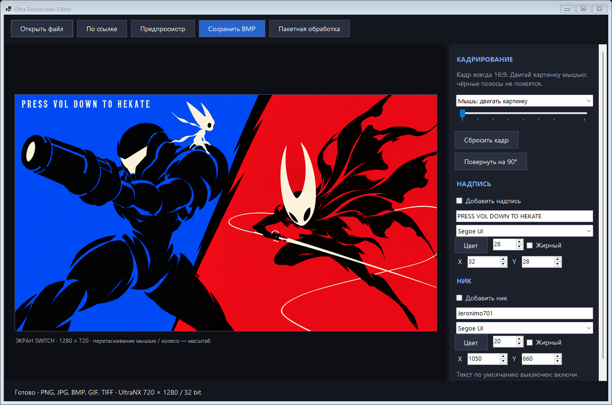
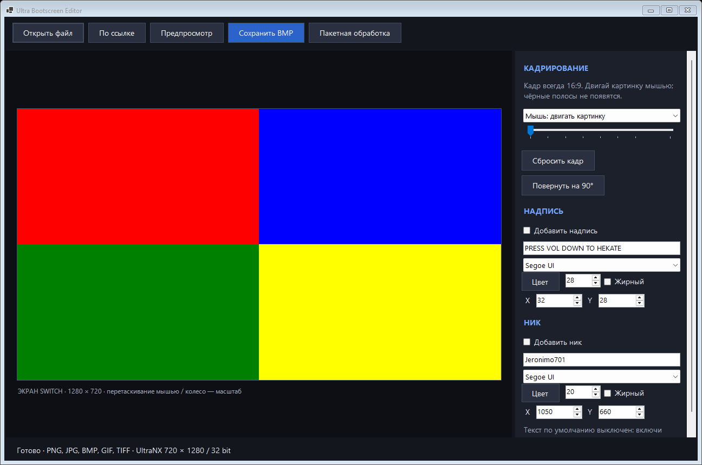

# Ultra Bootscreen Editor 1.0.0

Windows 10/11 x64. Запусти `UltraBootscreenEditor.exe` из папки `release`.
Программа автономная: установка .NET не требуется.

[Скачать EXE версии 1.0.0](https://github.com/jeronimo701/ultra-bootscreen-editor/releases/tag/v1.0.0).
Автор: Jeronimo701. Это редактор для ПК, отдельный от
[Ultra Bootscreen Manager 1.1.1 для Switch](https://github.com/jeronimo701/ultra-bootscreen-manager).

## Интерфейс

Снимки окна, отрисованного встроенным режимом `--capture` на Windows.




## Как сделать заставку

1. Нажми «Открыть файл» или перетащи изображение в окно. «По ссылке» загружает
   картинку по прямому HTTP/HTTPS-адресу; страница сайта не подходит.
2. Передвинь изображение мышью, увеличь колесом или ползунком. Кадр всегда 16:9.
3. Если нужны текст или ник, включи нужные слои справа. Выбери шрифт, размер,
   цвет и положение X/Y. Для перетаскивания текста выбери соответствующий режим мыши.
4. «Предпросмотр» показывает результат в отдельном окне с областью 1280×720.
5. Нажми «Сохранить BMP», выбери имя и папку.

Готовый файл — BMP 720×1280, 32 bpp, без сжатия, с поворотом против часовой
стрелки. Заголовок и длина соответствуют исходной заставке UltraNX.
Для установки переименуй файл в `bootscreen.bmp` и скопируй в `bootloader/res/`.
Либо положи BMP с любым именем в `switch/UltraBootscreenManager/bootscreens/`
и установи его через Manager. Сохрани резервную копию SD перед ручной заменой.
Программа сама не меняет содержимое SD-карты, если ты не выбрал её при сохранении.

Поддерживаются PNG, JPEG, BMP, GIF (первый кадр), TIFF.
Готовые BMP Ultra размером 720×1280 автоматически показываются в горизонтальном виде.
Для обычной вертикальной BMP такой же величины есть кнопка поворота.
Лимит загрузки: 80 МБ, 16000 px на сторону и 80 мегапикселей.

Ctrl+O — открыть. Ctrl+S — сохранить. Esc закрывает окно предпросмотра.

## Пакетная конвертация

«Пакетная обработка» → выбери несколько изображений → выбери папку.
Каждое изображение обрезается по центру под 16:9, без увеличения и смещения,
заданных для одиночной картинки. Включённые текстовые слои добавляются ко всем
файлам в тех же позициях. При совпадении имён добавляется суффикс `-2`, `-3` и т. д.
Исходники и ранее существующие файлы не перезаписываются.

## Сборка и проверка

`./build.ps1` использует SDK .NET 10 из PATH и создаёт автономный EXE.
Для другого компьютера передай путь к `dotnet.exe` через параметр `-Dotnet`.
Результаты проверок лежат в `verification/results.txt`.
Проверяются формат BMP, точное соответствие заголовка оригиналу, ориентация
всех пикселей, цветовые каналы, кадрирование, текст, загрузка HTTP и защита файлов.

Запуск тестов из PowerShell (папка вывода должна быть отдельной, без ваших файлов):

```powershell
$process = Start-Process .\release\UltraBootscreenEditor.exe -ArgumentList '--self-test verification' -Wait -PassThru
if ($process.ExitCode) { throw 'Self-test failed' }
Get-Content .\verification\results.txt
```

Подробности повторной проверки публикации: [VALIDATION.md](VALIDATION.md).
Приложение не подписано цифровой подписью. Проверка на физической Switch
не выполнялась; Editor не прошивает устройство и не устанавливает заставку сам.

## Авторство и компоненты

Отдельная лицензия на авторский код пока не выбрана; открытый доступ
не означает автоматически свободную лицензию. Уведомления о включённом
.NET runtime: [THIRD-PARTY.md](THIRD-PARTY.md). Это не официальный продукт
Nintendo, Microsoft или UltraNX.
